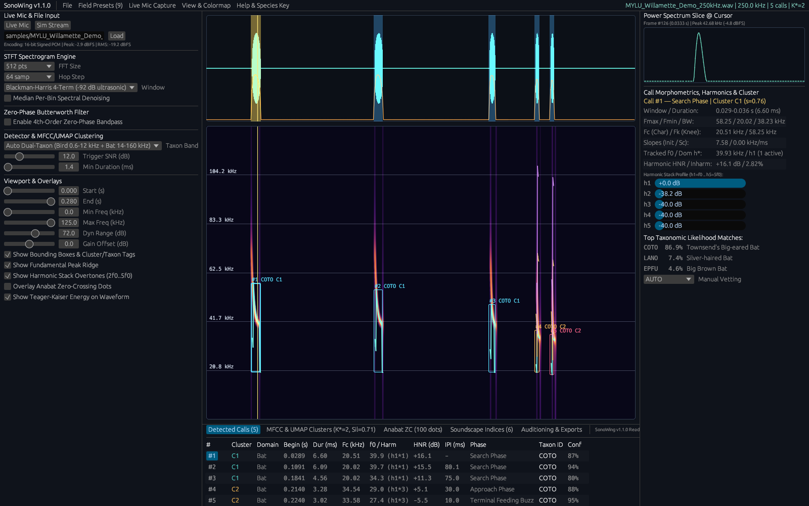

# SonoWing (`sonowing` v1.1.0)



Native safe-Rust (`#![forbid(unsafe_code)]`) desktop GUI workstation (`eframe` / `egui` `0.31`) and headless parallel CLI (`clap` `4.5` + `rayon` `1.10`) for **Chiropteran (bat) ultrasonic echolocation** and **Avian (bird) nocturnal flight call (`NFC`) & song** waveform, spectrogram, unsupervised `MFCC`/`UMAP` clustering, harmonic stack tracking, live microphone capture, and soundscape analysis.

## What's New in `v1.1.0`

- **Unsupervised Syllable & Pulse `MFCC` + `UMAP`-Style Manifold Clustering (`src/mfcc_cluster.rs`)**:
  - Dual-scale `24`-filter Mel / Ultrasonic Log-Mel filterbank + orthonormal `DCT-II` (`13` static cepstra `c0..c12` + `5` temporal delta-MFCCs `dc1..dc5` + `4` standardized contour features) per [Davis & Mermelstein (1980)](https://courses.physics.illinois.edu/ece417/fa2017/davis80.pdf).
  - Deterministic PCA spectral seeding + fuzzy simplicial `k`-NN cross-entropy force layout ([McInnes, Healy & Melville 2018](https://arxiv.org/abs/1802.03426); [Sainburg, Thielk & Gentner 2020](https://journals.plos.org/ploscompbiol/article?id=10.1371/journal.pcbi.1008228)) paired with `k`-Means++ and automatic Rousseeuw Silhouette `K*` selection (`K = 2..6`).
- **Subharmonic Summation (`SHS`) Multi-Harmonic Stack Tracker (`src/harmonic_tracker.rs`)**:
  - Tracks `f0(t)` and active overtones `2f0..5f0` across each call, quantifying active harmonic count (`1..5`), dominant harmonic order (`h* = 2` in whisper bats such as *Corynorhinus townsendii*), Harmonic-to-Noise Ratio (`HNR dB`), spectral inharmonicity (`%`), and spectrogram overtone contours.
- **Live Microphone & Ultrasonic UAC2 Spectrogram Capture (`src/live_mic.rs`)**:
  - Cross-platform real-time audio capture via [`cpal`](https://lib.rs/crates/cpal) supporting both `44.1/48 kHz` bird microphones and `192–384 kHz` USB UAC2 ultrasonic bat microphones, plus a built-in `192 kHz` simulated nocturnal stream and `sonowing record-mic` CLI subcommand.
- **9 Calibrated Field Benchmark Presets (`src/synth_presets.rs`)**:
  - Adds `A4` (*Ixoreus naevius* & *Megascops kennicottii* `f0..5f0` multi-harmonic stack benchmark) alongside `B1–B4`, `A1–A3`, and `M1`.

## Core Bioacoustic Architecture (`v1.0.0` + `v1.1.0`)

- **WAV, GUANO v1.0 & Anabat `.zc` I/O (`src/wav_guano.rs`)**: `8/16/24/32-bit` PCM & `32-bit` IEEE float up to `500 kHz`, [GUANO v1.0](https://github.com/riggsd/guano-spec/blob/master/guano_specification.md) (`guan` subchunk), [Wildlife Acoustics `WA|*`](https://www.wildlifeacoustics.com/SCHEMA/GUANO.html), and `.zc` waveform reconstruction.
- **DSP & Ultrasonic Auditioning (`src/dsp.rs`, `src/ultrasonic_audio.rs`)**: Radix-2 FFT/IFFT, `Blackman-Harris 4-Term` / `Hann` / `Hamming` / `Kaiser-Bessel`, zero-phase Butterworth `filtfilt`, [Teager-Kaiser Energy (`TKEO`)](https://www.semanticscholar.org/paper/On-a-simple-algorithm-to-calculate-the-%27energy%27-of-Kaiser/7def62fa76a7342a6d0187836ef821ef92d0de8a), `10x`/`20x` Time Expansion, Digital Heterodyne, and Frequency Division.
- **20-Species Taxonomic Key & Ecoacoustics (`src/taxa_library.rs`, `src/soundscape_indices.rs`, `src/exporters.rs`)**: [USGS NABat OFR 2018-1068](https://pubs.usgs.gov/of/2018/1068/ofr20181068.pdf), [SonoBat Western Features](http://www.sonobat.com/Acoustic_features_of_Western_US_Bats.pdf), [Andrews et al. 2006 (*Rhinolophus*)](https://bioone.org/journals/acta-chiropterologica/volume-8/issue-1/1733-5329_2006_8_197_USCOGH_2.0.CO_2/Ultrasound-social-calls-of-greater-horseshoe-bats-Rhinolophus-ferrumequinum-in/10.3161/1733-5329(2006)8[197:USCOGH]2.0.CO;2.short), [Farnsworth 2005 (NFCs)](https://bioone.org/journals/the-auk/volume-122/issue-3/0004-8038_2005_122_0733_FCATVF_2.0.CO_2/FLIGHT-CALLS-AND-THEIR-VALUE-FOR-FUTURE-ORNITHOLOGICAL-STUDIES-AND/10.1642/0004-8038(2005)122%5B0733:FCATVF%5D2.0.CO;2.full), [Alcocer et al. 2022 Ecoacoustic Indices](https://pmc.ncbi.nlm.nih.gov/articles/PMC9804652/), and [Raven Pro Selection Tables](https://www.ravensoundsoftware.com/knowledge-base/error-opening-selection-table/).

## Quick Start & Build Commands

```bash
# Run full unit & integration test suite (use --no-default-features on headless Linux without ALSA headers)
cargo test

# Launch native desktop GUI workstation
cargo run --release

# Capture 4 seconds of live microphone audio (or --simulated) to GUANO WAV
cargo run --release -- record-mic --seconds 4.0 --output live_capture.wav

# Headless inspection with MFCC/UMAP clusters, harmonic stacks, Raven TSV & CSV export
cargo run --release -- inspect samples/MYLU_Willamette_Demo_250kHz.wav \
  --raven-out mylu.Table.1.selections.txt \
  --csv-out mylu_v1_1_summary.csv
```
